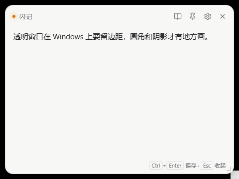
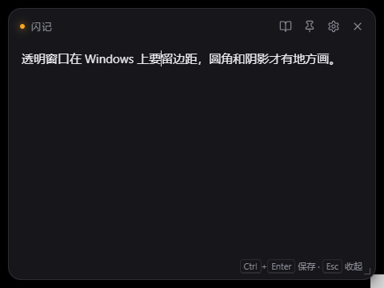
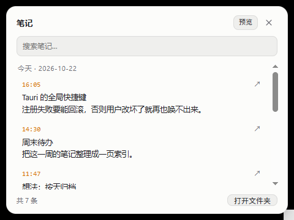
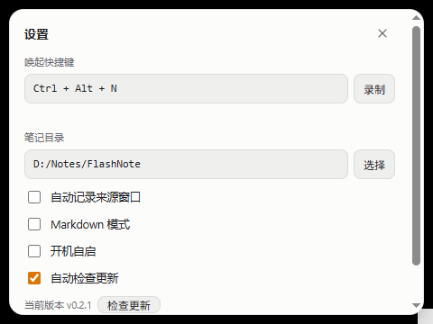

# FlashNote

**English** | [中文](README.md)

> A desktop quick-note popover that keeps your train of thought intact while you read articles or watch videos.

Press the global hotkey and a small window floats above the current window; jot down the thought, press `Ctrl+Enter` to save, and the window tucks itself away with focus back on the article or player. Entries are appended by date to local Markdown files — no account, no cloud upload.

**Download**: [Latest release](https://github.com/ranger1112/flashnote/releases/latest)

| Popover (light) | Popover (dark) |
| --- | --- |
|  |  |
|  |  |

## Features

- **Global summon**: `Ctrl+Alt+N` by default; call up the popover from any application and press it again to dismiss.
- **Borderless floating window**: always-on-top, hidden from the taskbar, freely draggable and resizable, with position and size remembered automatically.
- **Two save modes**: "save and hide" by default; click the pin button for persistent mode, where the window stays open after saving.
- **Automatic source capture**: grabs the foreground window title when summoned and writes it into the entry when saving (Windows; can be disabled in settings).
- **Drafts never lost**: unsaved content is preserved when you dismiss with `Esc` and survives an app restart; drafts live in the app's config directory, so clearing browser data won't lose them.
- **Local-first**: Markdown split into files by day, readable directly with Obsidian, VS Code, and similar tools.
- **Markdown mode**: optional block-based writing so code blocks, tables, and headings render correctly from the very first line.
- **Note history**: the note button in the title bar opens a history panel with reverse-chronological browsing, full-text search (across all date files), and loading of older entries; you can toggle a rendered Markdown preview and edit or delete individual entries directly.
- **System tray**: left-click to summon; right-click to open today's notes, the notes folder, settings, or quit.
- **Single instance**: launching again only summons the existing window — no second tray icon or hotkey conflict.
- **Auto-update**: silently checks GitHub Releases on startup; when a new version appears, a banner shows at the bottom of the window — click it to download, verify the signature, and install, effective after restart.
- **Other**: optional launch at login, follows the system light/dark theme, multi-monitor boundary correction.

## Usage

| Action | Description |
| --- | --- |
| `Ctrl+Alt+N` | Global summon / dismiss (changeable in settings) |
| `Ctrl+Enter` or `Ctrl+S` | Save the current content |
| `Esc` | Dismiss the window; if the settings panel is open, closes the panel first |
| Note icon | Opens the note history panel; supports search, load more, preview, edit, and delete |
| Pin button | Toggles persistent mode: the window stays open after saving |
| Drag the title bar | Moves the window; the position is remembered automatically |
| Bottom-right handle | Drag to resize (minimum 380×240) |

If the content is empty when saving, the window simply dismisses and nothing is written to the file. Outside persistent mode, the window hides automatically after a successful save and focus returns to the previous application.

On first run a guide appears automatically, explaining the summon hotkey, where notes are saved, and what the pin does; it won't show again after you click "Get started", and you can revisit this information from settings later.

### Tray menu

Left-clicking the tray icon summons the popover directly; the right-click menu contains:

- **Show Quick Note**: same as the global hotkey.
- **View Notes**: summons the window and opens the note history panel.
- **Open Today's Note**: opens today's Markdown file with the system default application (usually VS Code / Typora; the file is created automatically if it doesn't exist).
- **Open Notes Folder**: opens the current notes directory.
- **Settings…**: summons the window and opens the settings panel.
- **Open Logs Folder**: opens the log directory, for troubleshooting.
- **Quit**: exits the application and releases the global hotkey.

## Settings

| Option | Description |
| --- | --- |
| Summon hotkey | Click "Record" and press a key combination; it must include at least one modifier (Ctrl / Alt / Shift / Win). On conflict, an error is shown and the previous hotkey is restored automatically; if the default hotkey is already taken at startup, the app falls back to an alternate combination and shows a notice in the window. |
| Notes directory | Changed via a folder picker; the directory is created automatically if it doesn't exist. |
| Capture source window | When off, the source title is no longer captured or written. |
| Markdown mode | When on, each entry is written as `### 时间` + the raw content, so block-level syntax such as code blocks and tables renders correctly; off by default. |
| Launch at login | Adds a startup entry for the current user; off by default. |
| Check for updates automatically | Silently checks for new versions on startup and rechecks every 6 hours while running; on by default. Turning it off stops queued checks immediately; you can still trigger a check manually with "Check for updates". |

Settings are stored at:

```
%APPDATA%\com.phoebe.flashnote\settings.json
```

Unsaved drafts are stored in `draft.txt` in the same directory and cleared automatically after a note is saved successfully.

Writes use a temp-file-plus-rename approach to avoid leaving corrupted JSON behind after an abnormal exit. If the file is already corrupt (for example, due to a bad manual edit), startup first backs it up as `settings.json.corrupt-<timestamp>`, then restores defaults and shows a notice.

## Data format

By default, notes are saved to `FlashNote\YYYY-MM-DD.md` under the system Documents folder; the directory can be changed in settings. The file for the day is created on the first write:

```markdown
# 2026-10-21

- 14:32 这里是一个想法
  第二行会缩进两格，仍属于同一条
  _来源：Google Chrome — 某篇文章_

- 15:02 另一个问题
  _来源：PotPlayer — 视频文件名_
```

Rules:

- Each entry starts with `- HH:MM ` using local time; crossing midnight writes to a new file automatically.
- Multi-line content is indented two spaces from the second line onward, keeping it part of the same entry.
- The source line uses the format `  _来源：窗口标题_` and is written only when capture succeeds; newlines in the title are collapsed into spaces.
- New notes are always appended; editing or deleting in the history panel rewrites only that day's file, creating a `2026-10-21.md.bak-<timestamp>` backup first (at most 5 kept per date).
- Files are UTF-8 without BOM with `\n` line endings.

### History panel

- Loads 100 entries at a time by default; "Load more" at the bottom pages further back.
- Search scans every `YYYY-MM-DD.md` in the notes directory, case-insensitive, covering body text, time, and source title, returning at most 200 results.
- "Preview" renders the entry content as Markdown (sanitized with DOMPurify); click again to return to the raw text. The toggle state is remembered.
- "Edit" rewrites the entry in place while preserving the source line and the original format (compact list / Markdown block); "Delete" requires a second click within 3 seconds to confirm.

### Markdown mode

When enabled, each entry becomes a "time heading + raw content" instead of a list prefix with continuation indentation, so code blocks, tables, and headings render correctly from the first line; the source is written as an HTML comment, invisible in reading view:

````markdown
# 2026-10-21

### 14:32
## 小标题

```js
const a = 1;
```

<!-- 来源：VS Code — notes.rs -->
````

This mode is off by default and can be toggled in settings. When off, the compact list format above is used; the two formats can coexist, and older entries are never rewritten.

## Installation

Download from [Releases](https://github.com/ranger1112/flashnote/releases/latest):

| Version | File | Description |
| --- | --- | --- |
| Installer | `FlashNote_<version>_x64-setup.exe` | Double-click to install; per-user installation, no administrator rights required |
| Portable | `FlashNote_<version>_portable_x64.zip` | Unzip and run `flashnote.exe` directly; nothing is written to an install directory |

Each release ships with a `SHA256SUMS.txt` that you can use to verify the download:

```powershell
Get-FileHash .\FlashNote_0.2.1_x64-setup.exe -Algorithm SHA256
```

Compare the output with the corresponding line in `SHA256SUMS.txt`.

The installers are unsigned, so SmartScreen may warn on first run; choose "More info → Run anyway".

Uninstall: Windows "Settings → Apps", or run `uninstall.exe` in the install directory.

An installer built from source is located at:

```
src-tauri\target\release\bundle\nsis\闪记_0.2.1_x64-setup.exe
```

## Development

### Requirements

- Windows 10 / 11
- Node.js 20+
- Rust stable (MSVC toolchain)
- Visual Studio Build Tools 2022 with the "Desktop development with C++" workload selected
- WebView2 Runtime (usually already included on Windows 10 1803+)

### Starting the development environment

```bash
npm install
npm run tauri dev
```

On Windows you can also use the wrapper scripts, which locate Rust and MSVC automatically (`vswhere` + common install paths) and load the environment:

```bat
scripts\dev.cmd
scripts\build.cmd
scripts\cargo.cmd test      :: equivalent to cargo test, but with the environment ready
```

If the toolchain is installed in a non-default location (for example `D:\BuildTools` or a custom `CARGO_HOME`), copy the example to `scripts\_env.local.cmd` and fill in the paths; the file is ignored by `.gitignore`:

```bat
copy scripts\_env.local.cmd.example scripts\_env.local.cmd
```

### Building the installer

```bash
npm run tauri build
```

Outputs:

- Executable: `src-tauri\target\release\flashnote.exe`
- NSIS installer: `src-tauri\target\release\bundle\nsis\闪记_0.2.1_x64-setup.exe`

### Testing

```bash
npm test                 # Frontend pure functions (hotkey parsing, search matching)
cd src-tauri && cargo test
```

Rust unit tests cover entry formatting, multi-line indentation, source-title normalization, file append separation, pagination, search, file rebuilding after edit/delete, atomic settings writes and corruption recovery, and path traversal validation for the notes directory; the frontend uses Vitest to cover `accelFromEvent` / `formatAccel` and search matching. Both run in CI.

### Releasing

Set the version to the same value in `package.json`, `src-tauri/Cargo.toml`, and `src-tauri/tauri.conf.json`, then tag:

```bash
git tag v0.2.0
git push origin v0.2.0
```

The `.github/workflows/release.yml` workflow builds the NSIS installer and portable zip, generates `SHA256SUMS.txt`, and creates a **draft** Release; review it and publish from GitHub. If the version numbers don't match, the workflow fails immediately, preventing a tagged release whose installer version differs.

Auto-update relies on two repository Actions secrets: `TAURI_SIGNING_PRIVATE_KEY` (the full minisign private key) and `TAURI_SIGNING_PRIVATE_KEY_PASSWORD`. The workflow uses them to generate `.sig` files and `latest.json`; builds made without them cannot pass update verification. Keep the private key backed up locally only — never commit it to the repository. After publishing, the `latest.json` URL is:

```
https://github.com/ranger1112/flashnote/releases/latest/download/latest.json
```

This URL only points to the latest **published** stable release; drafts and prereleases are not picked up by auto-update.

### Project structure

```
flashnote/
├─ index.html                  # DOM structure for the popover and settings panel
├─ src/
│  ├─ main.ts                  # Frontend state and interaction (saving, hotkey recording, drafts)
│  └─ styles.css               # Light/dark themes, floating card styles
├─ src-tauri/
│  ├─ src/
│  │  ├─ main.rs               # App entry: plugins, tray, single instance, hotkey registration
│  │  ├─ commands.rs           # Frontend/backend commands: show/hide, save, settings, geometry persistence
│  │  ├─ notes.rs              # Markdown entry formatting and per-day appending (with tests)
│  │  ├─ settings.rs           # Atomic settings.json read/write and defaults
│  │  ├─ source.rs             # Foreground window title capture (Win32)
│  │  └─ tray.rs               # Tray icon and menu
│  ├─ capabilities/default.json
│  ├─ icons/
│  ├─ tauri.conf.json
│  └─ Cargo.toml
├─ scripts/                    # Dev/build wrapper scripts and debugging tools
└─ package.json
```

## Technical notes

- **Framework**: Tauri 2 + Rust 2021, with a frontend built on plain TypeScript + Vite and no frontend framework.
- **Plugins**: `single-instance` (single instance), `global-shortcut` (global hotkeys), `autostart` (launch at login), `dialog` (directory picker), `updater` / `process` (update check, install, and restart).
- **Frontend/backend boundary**: the frontend never touches the filesystem directly; saving, settings, and window visibility all go through Tauri commands.
- **Window**: borderless with a transparent background; 10px of padding on all sides leaves room for CSS-drawn rounded corners and shadow; `skipTaskbar` keeps it out of the taskbar.
- **Source capture**: `GetForegroundWindow` + `GetWindowTextW`, excluding FlashNote itself by PID; if capture fails, the previous source is reused.
- **Saving**: appends to a file per date; the settings file is replaced atomically.
- **Logging**: written to `%LOCALAPPDATA%\com.phoebe.flashnote\logs`, rotating when a single file exceeds 2MB and keeping the 3 most recent files; openable directly from the tray menu. Logs never contain note bodies.

## Platform support

Currently verified only on **Windows 10/11**. Source-window capture relies on the Win32 API; other platforms omit the source line. macOS / Linux are untested.

## Known limitations

- No cloud sync or export yet; search scans files one by one, so it gets slower with very large note collections.
- If another application has claimed the global hotkey, you need to change it in settings.
- Note files are append-only and never rotated, so a single day's file grows gradually over long-term use.
- The installers are not code-signed.

## FAQ

**The hotkey doesn't respond?**

Most likely another application has claimed it. If registering the default hotkey fails at startup, FlashNote tries `Ctrl+Alt+M`, then `Ctrl+Shift+Alt+N`, and shows a notice in the window. You can also right-click the tray icon → Settings and click "Record" to pick another combination; the hotkey must include at least one of Ctrl / Alt / Shift / Win.

**Where are my notes stored?**

By default in `%USERPROFILE%\Documents\FlashNote`, one Markdown file per date; you can change the directory in settings, and the tray menu opens it directly. Drafts and settings live in `%APPDATA%\com.phoebe.flashnote`, and logs in `%LOCALAPPDATA%\com.phoebe.flashnote\logs`.

**How do I uninstall it?**

Uninstall "闪记" from Windows "Settings → Apps", or run `uninstall.exe` in the install directory (`%LOCALAPPDATA%\闪记`). Your notes directory is not deleted; remove it manually if needed.

**Why does Windows say "Windows protected your PC"?**

The installer is not code-signed, and SmartScreen blocks new programs with few downloads: click "More info" → "Run anyway". You can also verify file integrity with `SHA256SUMS.txt` from the release.

**Will upgrading touch my notes?**

No. Auto-update only replaces program files; notes, settings, and drafts all live in your user directory and are untouched by upgrades or uninstalls.

**Does it still go online after I turn off "Check for updates automatically"?**

No proactive network access. Once disabled, it only contacts GitHub Releases when you click "Check for updates" manually.

## Contributing

Issues and pull requests are welcome; see [CONTRIBUTING.md](CONTRIBUTING.md) for the exact process. Before submitting, make sure that:

- `npm run build` (type check + frontend build) passes;
- `cd src-tauri && cargo test` passes;
- generated directories such as `node_modules/`, `dist/`, and `src-tauri/target/` are not committed.

See [CHANGELOG.md](CHANGELOG.md) for version changes; report security issues privately as described in [SECURITY.md](SECURITY.md) instead of opening a public issue.

## License

This project is open source under the [MIT License](LICENSE).
